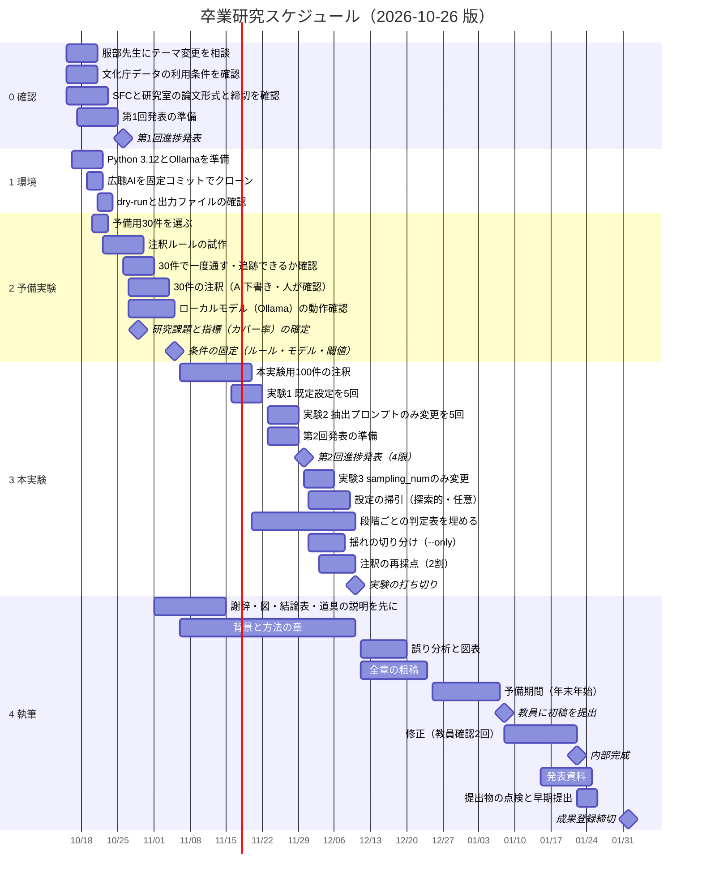

# 卒業研究スケジュール

最終更新：2026-10-26（Claude）。このファイルが日程の正本です。Claude・Codexとも、日程を変えたらこのファイルを直し、最終更新の行と末尾の変更履歴を更新してください。

- テーマ：AIによる意見集約は少数の理由をどこで失うか：広聴AIと文化庁パブリックコメントによる段階別の検証（2026-10-26 の第1回発表で異論なし）
- 学部の成果登録締切：2027-02-01（月）。研究室の論文締切・発表日は未確認。分かりしだい前倒しする。
- 日付は計画用の目安で、教員の指定・確認結果で変わる。「（未定）」は日付が決まっていないもの。

## ガントチャート

## 節目と判断

| 日付 | 節目 | その時点の判断 |
|---|---|---|
| 2026-10-21 | 教員とデータの確認 | テーマ変更が認められなければ、計画を組み直す |
| 2026-10-26 | 第1回進捗発表 | 実施済み。テーマ変更・予備実験・データの扱いに異論なし。指摘は「カバー率のような定量指標」と「ローカルモデルで設定を変える実験」。詳細は `docs/第1回発表_振り返り_2026-10-26.md` |
| 2026-10-29 | 研究課題と指標の確定 | 発表で異論がなかったので、研究課題にカバー率の定義を加えて固定する |
| 2026-11-05 | 条件の固定 | 注釈ルール（AI下書きの手順を含む）、モデル、プロンプト、少数の閾値（10%）、除外規則、ローカルモデルを掃引に使うかを決め、以後は変えない。30件が追跡できなければ対象を狭める |
| 2026-11-30 | 第2回進捗発表（4限） | 100件の注釈結果と実験1のカバー率を示す。できれば実験2の途中結果 |
| 2026-12-10 | 実験の打ち切り | 新しい条件は足さない。結果に合わせて目的を変えない |
| 2027-01-08 | 初稿 | 教員に全体を見せる |
| 2027-01-22 | 内部完成 | 研究室の締切が早ければ前倒し |
| 2027-02-01 | 成果登録締切 | 学部の公開日程による。時刻は要確認 |

## 進捗発表（約3回）

| 回 | 見せる内容 | 時期 |
|---|---|---|
| 1 | テーマ変更の理由、研究課題、新規性の範囲、データと実験計画、予備観察 | 2026-10-26 4限（実施済み） |
| 2 | 100件の注釈結果、実験1のカバー率、評価の妥当性、掃引の計画 | 2026-11-30 4限（決定） |
| 3 | 最終結果と限界 | 1月（未定） |

## 担当

- 本人：教員・データ提供元への確認、クローンと実行、注釈と採点、執筆。
- Claude・Codex：調べもの、手順や設計の提案、文章の点検。本人の指示なしにコードを実装・実行しない。

## 変更履歴

- 2026-10-26：第1回発表を実施済みに変更し、第2回発表を 11/30 4限 に設定。30件の注釈・ローカルモデルの動作確認・第2回発表準備・設定の掃引を追加。10/29 の節目を「研究課題と指標の確定」に読み替え（Claude）。
- 2026-10-19：フォルダ整理により docs/ に移動（内容は不変）（Claude）。
- 2026-10-16：第1回進捗発表を10/26（予定）に設定し、準備期間を追加（Claude）。
- 2026-10-15：初版（Claude）。研究テーマ検討メモの仮スケジュールをもとに、広聴AIのみ・5回反復・再現性の確認を反映。
